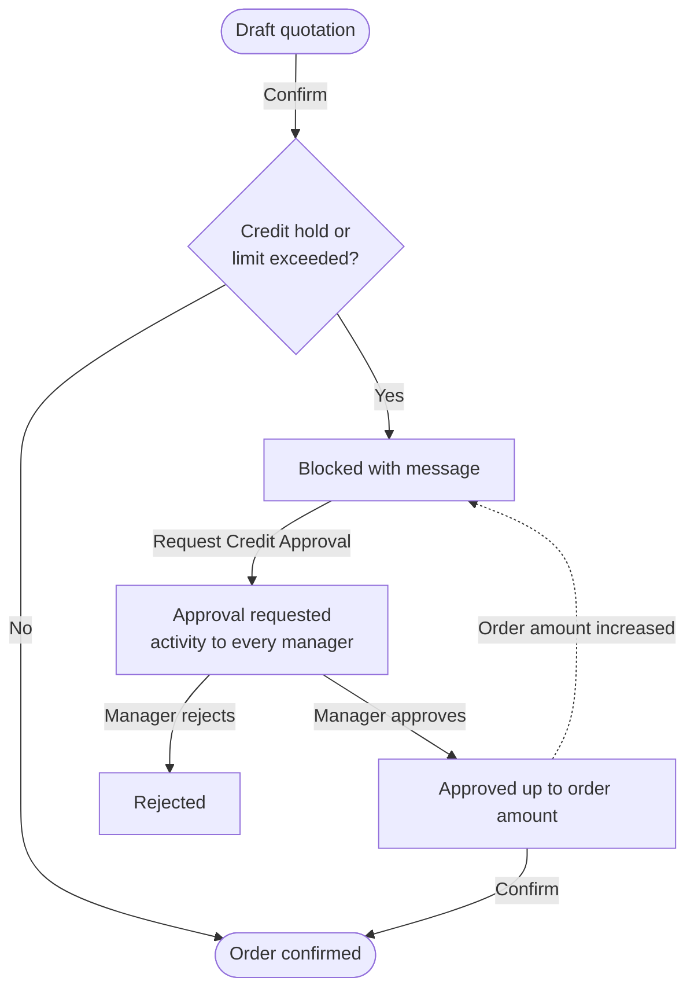
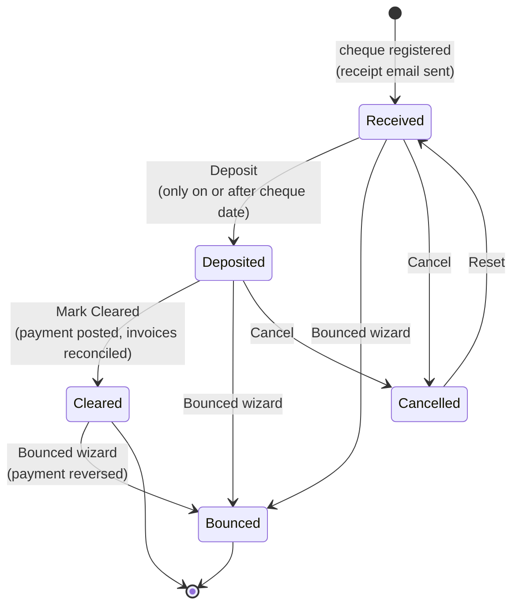
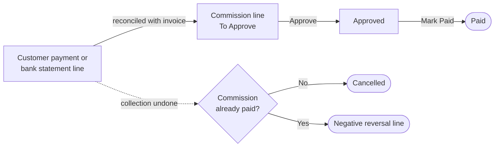
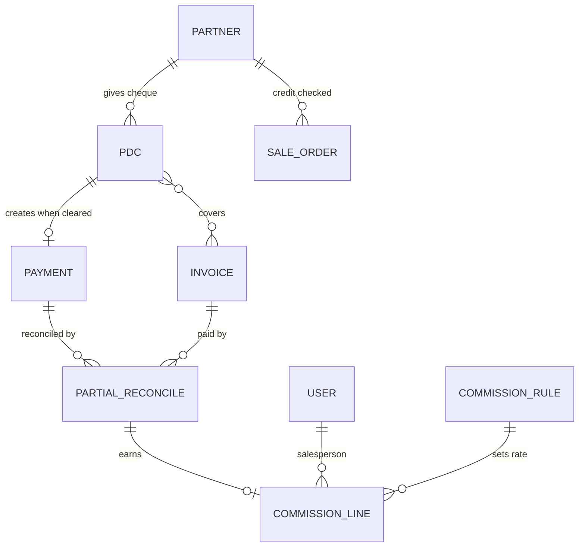

# Credit Control, PDC & Collection Commission

[](https://www.odoo.com)
[](https://www.gnu.org/licenses/lgpl-3.0)

An Odoo 19 module for businesses that sell **on credit and collect by cheque**. It covers customer credit limits with manager approval, a post-dated cheque (PDC) register, sales commission paid **on collection** (not on invoicing), automatic overdue reminders, receivable aging reports, and a customer portal with online payment through **SSLCommerz**.

[**[See Screenshots]**](#screenshots)

---

## Features

| Area | What you get |
|------|--------------|
| **Credit limits** | Per-customer credit limit, enforced when a sales order is confirmed. Exposure = open receivable + confirmed-but-not-invoiced orders. |
| **Credit hold** | One switch blocks every new sales order for a customer until a credit manager approves it. |
| **Approval workflow** | Salesperson requests an override, managers get an activity, and the approval is valid only up to the approved amount. |
| **PDC register** | Auto-numbered cheques (`PDC/YYYY/0001`) with Received → Deposited → Cleared / Bounced / Cancelled states. |
| **Cheque clearing** | One click posts the customer payment in the bank journal and reconciles the linked invoices. |
| **Bounce handling** | Wizard records the reason and an optional bounce charge. Invoices become due again, activities are scheduled, and the customer is emailed. |
| **Auto credit hold** | Customer is put on hold automatically after *N* bounced cheques (configurable). |
| **Maturity alerts** | Daily cron schedules a "deposit this cheque" activity once the cheque date is reached. |
| **Collection commission** | Commission accrues on every collection, based on the untaxed part of the money received. Rate comes from rules (per salesperson, fast-collection bonus). |
| **Commission reversal** | If a collection is undone (cheque bounced, payment unreconciled), the commission is cancelled or counter-booked. |
| **Overdue reminders** | Daily cron emails customers about overdue invoices, skipping invoices that have a cheque in hand. |
| **Aging reports** | SQL-based receivable aging (Not Due, 1-30, 31-60, 61-90, 90+) with pivot, list and graph views. |
| **Customer statement** | PDF credit statement with limit, exposure, aging, open items and cheques. |
| **Customer portal** | Customers see their credit position, aging, open items and cheques, download the statement, and pay online. |
| **Security** | Two-level role model, record rules for salespeople and portal customers, and multi-company support. |

---

## Workflow

### Credit check on sales orders



Credit exposure is calculated in the company currency:

```
exposure = open receivable (posted, unreconciled) + confirmed orders not yet invoiced
```

| Status | When |
|--------|------|
| **No Limit** | Credit check is off for the customer |
| **OK** | Exposure is below 80% of the limit |
| **Near Limit** | Exposure is 80% of the limit or more |
| **Exceeded** | Exposure is above the limit |
| **On Hold** | Credit hold is switched on |

An approval is tied to the amount: if the order total grows beyond the approved amount, a new approval is needed.

### Cheque (PDC) lifecycle



| Step | Action | What happens automatically |
|------|--------|----------------------------|
| 1. **Register** | Enter customer, cheque no., bank, cheque date, amount and optional invoices | Reference number is generated. Receipt email goes to the customer. Duplicate cheques (same number, bank and customer) are rejected. |
| 2. **Deposit** | Only once the cheque date has arrived and a bank journal is selected | Deposit date is stamped. |
| 3. **Mark Cleared** | Cheque must be deposited | An inbound payment is created and posted in the bank journal, then reconciled with the open invoices. |
| ✖ **Bounced** | Wizard asks for reason and optional bounce charge | See below. |
| **Cancel / Reset** | Cancel a received or deposited cheque, and reset it to Received | Only received or cancelled cheques can be deleted. |

**When a cheque bounces:**

- If it was already cleared, the payment is reversed, so the invoices become due again.
- A bounce charge invoice is created and posted when a fee is entered. It has no salesperson, so it earns no commission.
- The overdue-reminder timer of the linked invoices is reset, so the next reminder run picks them up.
- An activity is scheduled for the salesperson of each invoice and for the collector.
- The customer receives a bounce notice by email.
- If the customer has reached the *Auto Credit Hold* threshold, credit hold is switched on and logged on the customer.

### Commission on collection



- One commission line is created per partial reconciliation between a customer invoice and a **real collection** (a payment or bank statement line). Credit notes and exchange differences do not earn commission.
- **Commission base** = collected amount × (untaxed total ÷ total) of the invoice, so tax is excluded.
- **Rate** is taken from the first matching rule (ordered by sequence). A rule can be limited to one salesperson and to collections made within *N* days of the invoice date. If no rule matches, the default rate applies.
- Invoices without a salesperson earn no commission.
- Managers approve lines and mark them paid. Lines can be reset to draft.

### Automation (scheduled actions)

| Cron | Interval | Job |
|------|----------|-----|
| `Credit Control: Overdue Invoice Reminders` | Daily | Emails customers about overdue posted invoices, at most every *N* days per invoice, up to 100 per run. Skips invoices with a cheque in hand and customers without an email address. |
| `PDC: Maturity Alerts` | Daily | Schedules a "Deposit cheque" activity for the collector (or admin) when a received cheque reaches its date. |

Each record is processed inside its own savepoint, so one failure never blocks the rest.

### Customer portal

| Page | URL | Content |
|------|-----|---------|
| Credit and Dues | `/my/credit` | Credit limit, outstanding, available credit, overdue, usage bar, aging summary, open items with **Pay Now**, and cheques |
| Statement | `/my/credit/statement` | Credit statement PDF download |
| My Cheques | `/my/pdc` | The customer's last 100 cheques with status |
| Portal home | `/my` | Two entries, with a cheque counter |

**Pay Now** opens the invoice portal page, where the customer pays online (SSLCommerz). **Pay All Overdue** uses the standard `/my/invoices/overdue` page. Portal users only ever see data of their own commercial partner.

---

## Roles & Security

| Role | Can do |
|------|--------|
| **Credit and PDC: User** | See and manage cheques (no delete), read commission rules, see own commission lines and own customers' aging. Granted automatically to **Salespeople** and **Invoicing accountants**. |
| **Credit and PDC: Manager** | Everything above plus: change credit limits and holds, approve or reject credit overrides, approve and pay commission, manage commission rules, delete cheques, open Settings. Inherits User. |
| **Accountant** (Invoicing) | See all commission lines and the full aging report. Deposit, clear and bounce cheques. |
| **Portal customer** | Read-only access to their own cheques |

Other security points:

- Only managers can change **Enforce Credit Limit**, **Credit Limit** and **Credit Hold** on a customer. Other users see these fields read-only.
- Credit approval and rejection are manager-only.
- Multi-company record rules apply to cheques, commission lines and the aging report.
- The installer adds the **Admin** user to the Manager group.

---

## Configuration

**Credit and PDC → Configuration → Settings**

| Setting | Default | Meaning |
|---------|---------|---------|
| Default PDC Bank Journal | none | Journal pre-selected on new cheques for deposit and clearing |
| Auto Credit Hold After N Bounced Cheques | `0` | Put the customer on hold after this many bounced cheques (0 = off) |
| Default Commission Rate (%) | `2.0` | Used when no commission rule matches |
| Overdue Reminder Every (days) | `7` | Days between reminder emails for the same invoice (0 = off) |

Other setup:

- **Commission Rules** (*Configuration → Commission Rules*): sequence, optional salesperson, optional "collected within N days", and rate.
- **Customer credit policy**: open the customer, then the **Credit Control** tab, then set *Enforce Credit Limit*, *Credit Limit* and *Credit Hold*.
- **Outgoing mail server** must be configured for receipts, bounce notices and reminders.

---

## Installation

### Requirements

- Odoo **19.0**
- Odoo apps: `base`, `mail`, `sale`, `account`, `portal`, `payment`, `account_payment`
- A `payment_sslcommerz` provider module, available in your addons path

> The manifest depends on `payment_sslcommerz`, which is not part of standard Odoo. If you do not use SSLCommerz, remove it from `depends` in `__manifest__.py`. Everything else still works with any other payment provider.

### Steps

```bash
# 1. Copy the module into your custom addons directory
cp -r credit_pdc_commission /path/to/custom_addons/

# 2. Add the directory to addons_path in odoo.conf
#    addons_path = /opt/odoo/addons,/path/to/custom_addons

# 3. Restart Odoo and install
./odoo-bin -c odoo.conf -d <your_db> -i credit_pdc_commission
```

Or: **Apps → Update Apps List → search "Credit Control" → Install**.

---

## Module Structure

```
credit_pdc_commission/
├── __init__.py                  # post_init_hook (admin → manager)
├── __manifest__.py              
├── controllers/
│   └── portal.py                # /my/credit, /my/credit/statement, /my/pdc
├── data/
│   ├── sequence_data.xml        # PDC/YYYY/0001
│   ├── mail_template_data.xml   # overdue reminder, cheque received, cheque bounced
│   └── cron_data.xml
├── models/
│   ├── utils.py                 # Aging buckets and helpers
│   ├── res_partner.py           # Credit fields, exposure, statement data
│   ├── res_config_settings.py
│   ├── sale_order.py            # Credit check and approval workflow
│   ├── account_move.py          # Cheque links, days overdue, reminder cron
│   ├── account_payment.py       # Link to cheque, invoice reconciliation
│   ├── account_partial_reconcile.py  # Hooks that create/reverse commission
│   ├── pdc.py                   # Cheque register and workflow
│   ├── commission.py            # Rules and commission lines
│   └── aging_report.py          # SQL view
├── wizard/
│   └── pdc_bounce_wizard.py
├── report/
│   ├── customer_statement.py
│   ├── report_actions.xml
│   └── report_templates.xml     # Credit statement PDF
├── security/
│   ├── security.xml             # Groups & record rules
│   └── ir.model.access.csv
├── static/
│   ├── description/
│   │   └── icon.png
│   └── src/
│       ├── css/
│       │   └── report_fonts.css          
│       └── fonts/
│           ├── NotoSansBengali-Regular.ttf   
│           └── NotoSansBengali-Bold.ttf      
└── views/                       # Backend views, menus, portal templates
```

---

## Data Model



---

## Screenshots


---

## Notes

- Credit limits and exposure are tracked on the **commercial partner**, so contacts of a company share one limit.
- Exposure uses the **current company** and is calculated in the company currency. Orders in other currencies are converted at the order date.
- Commission is created by the reconciliation itself, so it works for cheque clearing, manual payments and bank statement reconciliation alike.
- Bounce charge invoices carry no salesperson and therefore never generate commission.
- An order can be confirmed without the credit check only through code, by passing the context key `cc_skip_credit_check`.

---

## License

Distributed under the **LGPL-3** license.
